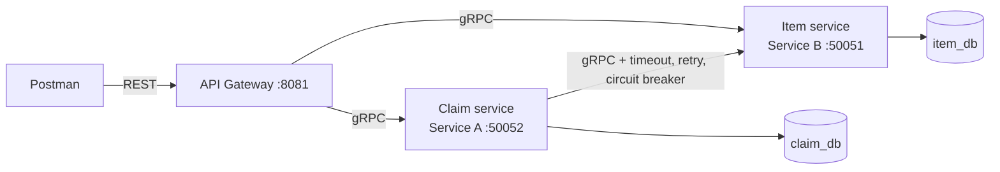

# Lost & Found: Two Collaborating Microservices (WEB303)

A small distributed application for a campus lost-and-found desk.

| Service | Role | Owns | Database |
|---|---|---|---|
| **item-service** (Service B) | independent resource | `items` (things that were found) | `item_db` |
| **claim-service** (Service A) | depends on items | `claims` (people claiming an item) | `claim_db` |
| **gateway** | REST entry point | nothing (stateless) | none |

A claim can only be created for an item that exists. Claim service verifies this by calling
the Item service over gRPC. It never touches the item database.

## Architecture



Only the gateway's port is published to the host. Everything else is reachable only inside the Docker network.

## Run it

Prerequisites: Docker Desktop (with Compose v2). Nothing else is needed. The gRPC code is generated inside the Docker build.

```bash
docker compose up --build
```

The gateway is then available at `http://localhost:8081`. Check with `curl http://localhost:8081/health`.
Reset data: `docker compose down -v`.

Import `postman_collection.json` into Postman (the `base_url` variable is `http://localhost:8081`).
Run the folders in order. Create requests save the new ids into collection variables automatically.

### Optional: generate protobuf code locally
Install `protoc`, `protoc-gen-go` and `protoc-gen-go-grpc`, then run `make proto` and `go mod tidy`.

## REST API (gateway)

| Method | URL | Success | Description |
|---|---|---|---|
| POST | `/items` | 201 | create item |
| GET | `/items` | 200 | list items |
| GET | `/items/{id}` | 200 | get item |
| PUT | `/items/{id}` | 200 | update item (full replace) |
| DELETE | `/items/{id}` | 204 | delete item |
| POST | `/claims` | 201 | create claim (verifies item via gRPC) |
| GET | `/claims` | 200 | list claims |
| GET | `/claims/{id}` | 200 | get claim (adds `item_name` from Item service) |
| PUT | `/claims/{id}` | 200 | update claim |
| DELETE | `/claims/{id}` | 204 | delete claim |
| GET | `/health` | 200 | gateway health |

Example bodies:

```json
POST /items   {"name": "Black Backpack", "description": "Nike, red keychain", "location_found": "Library"}
PUT  /items/1 {"name": "...", "description": "...", "location_found": "...", "status": "FOUND|CLAIMED|RETURNED"}
POST /claims  {"item_id": 1, "claimant_name": "Pema Wangmo", "claimant_email": "pema@example.com"}
PUT  /claims/1 {"claimant_name": "...", "claimant_email": "...", "status": "PENDING|APPROVED|REJECTED"}
```

### gRPC error to HTTP mapping

| gRPC code | HTTP |
|---|---|
| `INVALID_ARGUMENT` | 400 |
| `NOT_FOUND` | 404 |
| `ALREADY_EXISTS`, `FAILED_PRECONDITION` | 409 |
| `UNAVAILABLE` | 503 |
| `DEADLINE_EXCEEDED` | 504 |
| anything else | 500 |

Error bodies look like `{"error": "item 99999 not found", "grpc_code": "NotFound"}`.

## Validation

- Item: `name` required (max 100), `location_found` required (max 200), `description` max 500, `status` one of FOUND/CLAIMED/RETURNED (update).
- Claim: `item_id` positive integer, `claimant_name` required (max 100), `claimant_email` must be a valid email, `status` one of PENDING/APPROVED/REJECTED (update).
- Path ids must be positive integers. Request bodies must be valid JSON with no unknown fields.
- Validation happens in the services before any database write, so invalid data is never stored.

## Resilience (Claim service to Item service)

Implemented in `claim-service/itemclient.go`:

| Pattern | Behaviour | Env var |
|---|---|---|
| Timeout | each attempt limited to 2000 ms | `ITEM_CALL_TIMEOUT_MS` |
| Retry with backoff | up to 3 attempts, waits 200 ms then 400 ms; only for `UNAVAILABLE` / `DEADLINE_EXCEEDED` | `ITEM_MAX_ATTEMPTS`, `ITEM_BACKOFF_MS` |
| Circuit breaker | opens after 3 consecutive failed calls, stays open 10 s, then lets one trial call through (half-open) | `CB_FAILURE_THRESHOLD`, `CB_OPEN_SECONDS` |

`NOT_FOUND` is a normal answer from a healthy service, so it is not retried and does not trip the breaker.

When Item service is down:
- `POST /claims` returns **503** with a clear message (no hanging, no crash).
- `GET /claims/{id}` returns **200** with a **fallback** `item_name` ("unavailable: item service is down").

### Demo
```bash
docker stop item-service
# send POST /claims 4-5 times, then watch:  docker logs claim-service
docker start item-service      # wait ~10 s, send again: breaker recovers
```

## Configuration

All ports, database credentials and resilience settings are read from environment variables (see `.env`, passed through `docker-compose.yml`). Nothing is hard-coded.

## Project structure

```
proto/            item.proto, claim.proto
item-service/     Service B: main.go, db.go, server.go, Dockerfile
claim-service/    Service A: main.go, db.go, server.go, itemclient.go, Dockerfile
gateway/          main.go, handlers.go, httputil.go, Dockerfile
docker-compose.yml, .env, Makefile, postman_collection.json
```
Each Dockerfile is multi-stage: a `golang` build stage (generates gRPC code and compiles) and a small `alpine` runtime stage with only the binary, running as a non-root user.
